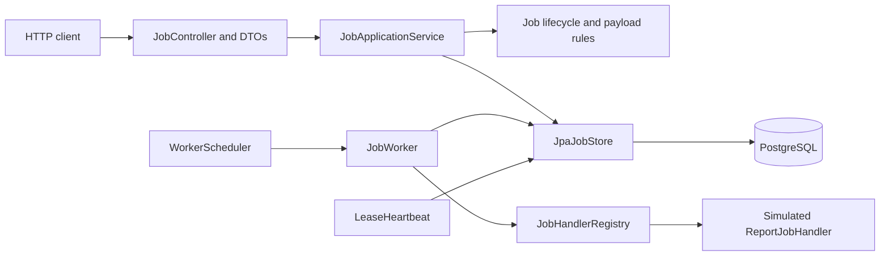
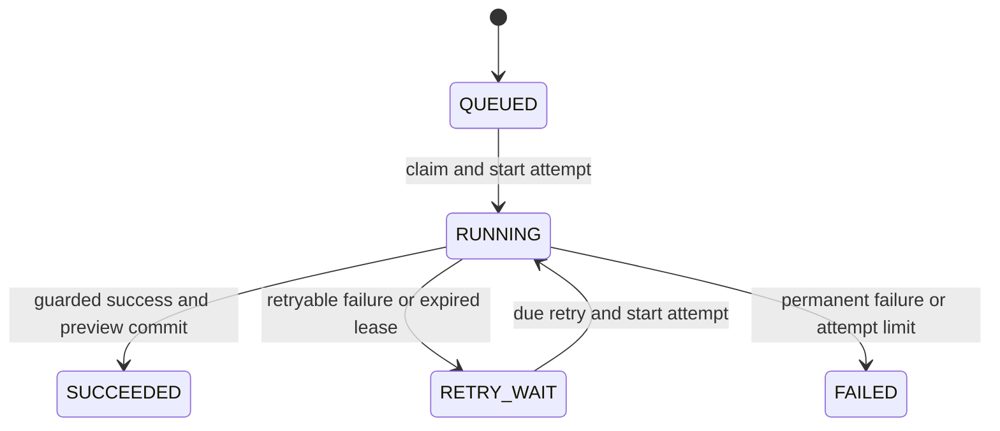
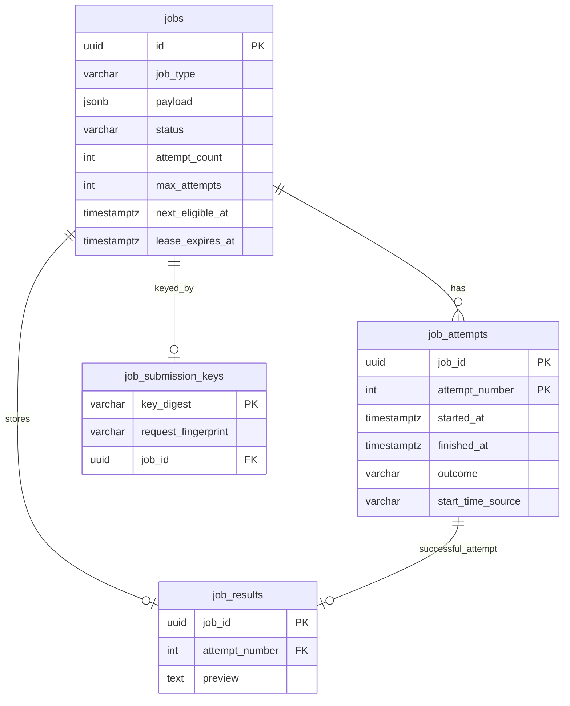

# TaskForge architecture

TaskForge is one Spring Boot application with an HTTP API and a scheduled worker. PostgreSQL is the source of truth for jobs, attempts, submission keys, and stored previews. Docker Compose supplies PostgreSQL locally; Redis and a separate worker service are not required.



The controller handles HTTP, validation, response shapes, and safe errors. The application service coordinates use cases. The immutable `Job` domain model checks legal transitions without Spring or JPA annotations. `JpaJobStore` maps it to database rows and owns transactional lifecycle operations. The worker calls an allowlisted handler; it never executes code supplied by a client.

## Lifecycle



`attemptCount` starts at zero and increases **only when `Job.start()` begins an attempt**. The default maximum is three started attempts. Scheduling a retry leaves the count unchanged. `SUCCEEDED` and `FAILED` are terminal; this version has no cancellation or manual retry operation. A `RETRY_WAIT` job is claimable only after its stored `nextEligibleAt` is due according to PostgreSQL time.

The default backoff is `min(300 seconds, 5 seconds × 2^(attemptCount−1))`: after attempt 1, five seconds; after attempt 2, ten seconds. Attempt 3 cannot schedule another retry. Only an explicit `RetryableJobException` or an expired lease is retryable. A missing handler and other handler exceptions fail permanently with a safe reason. No transaction or worker thread waits through the backoff period.

## Submission to result

```mermaid
sequenceDiagram
    autonumber
    participant Client
    participant API as JobController
    participant Service as JobApplicationService
    participant Store as JpaJobStore
    participant DB as PostgreSQL
    participant Worker as JobWorker
    participant Handler as ReportJobHandler
    Client->>API: POST /api/v1/jobs
    API->>Service: validate and submit
    Service->>Store: create queued job, optionally with key
    Store->>DB: insert job and optional key in one transaction
    DB-->>Store: commit
    API-->>Client: 201 Created (or 200 matching replay)
    Worker->>Store: claimNextEligible()
    Store->>DB: lock eligible job; start and insert attempt
    DB-->>Store: commit RUNNING
    Store-->>Worker: claim handle
    Worker->>Handler: execute validated payload outside transaction
    Handler-->>Worker: bounded text preview
    Worker->>Store: completeSuccess(claim, preview)
    Store->>DB: lock and check ownership; close attempt, insert result, set SUCCEEDED
    DB-->>Store: commit all three changes
    Client->>API: GET /api/v1/jobs/{id}/result
    API->>Service: getResult(id)
    Service->>Store: read stored job and result
    Store-->>Service: stored preview
    Service-->>API: result
    API-->>Client: 200 OK with stored preview
```

Submission returns after the queued row commits, without waiting for the handler. The only handler produces a deterministic **simulated text preview**. It does not create a file or contact an external service.

### Transactions and concurrent workers

`claimNextEligible()` selects one `QUEUED` job or due `RETRY_WAIT` job using `FOR UPDATE SKIP LOCKED`. PostgreSQL holds that job-row lock until the short claim transaction commits or rolls back. A competing worker skips a locked row and may claim another; processing is therefore not strictly first-in-first-out. Under the lock, the store takes a fresh `clock_timestamp()`, reconstructs and validates the domain job, calls `start()`, writes `RUNNING` and the numbered attempt, then commits **before** returning to `JobWorker`. Handler execution has no surrounding database transaction.

While the handler runs, a separate heartbeat thread can renew the lease. Renewal locks the job and succeeds only while it is `RUNNING`, the attempt number still matches, and `lease_expires_at` is later than fresh PostgreSQL time. A confirmed rejection marks ownership lost; a database error marks it unknown. Either makes the worker discard its handler result. A completion still independently locks the job and checks these predicates; the heartbeat's local state is not the final authority.

Each worker cycle may recover one expired `RUNNING` job before claiming one eligible job. Recovery uses `FOR UPDATE SKIP LOCKED`, checks expiry again after locking, closes that exact attempt, and moves the job to `RETRY_WAIT` or `FAILED` in one transaction. Success or failure completion likewise locks the job and changes its exact attempt and job state atomically. Success also inserts the preview in the same transaction; a failed insert rolls back the attempt closure and `SUCCEEDED` transition. An old attempt number cannot overwrite a newer attempt's rows. PostgreSQL time determines lease ownership and retry eligibility; domain transition timestamps are kept nondecreasing even if a stored `updatedAt` is ahead of database time.

This fences **TaskForge database state**, not the handler's execution. A slow old handler may continue after losing its lease, and a crash after handler work but before completion commits may cause another attempt. The simulated handler has no external effect; future effectful handlers would need their own idempotency or fencing. Exactly-once execution or effects are not claimed.

### Submission idempotency

An optional `Idempotency-Key` is trimmed and validated, then stored only as a SHA-256 digest. A versioned fingerprint covers the normalized job type and report name. PostgreSQL's unique key digest arbitrates concurrent submissions: a losing transaction rolls back its provisional job, and the application loads the winner in a fresh transaction. A matching replay returns `200 OK`, the original job ID and its **current** representation; a different logical request returns safe `409 Conflict`. Without a key, each POST creates a new job. Keys are global because there is no user identity, and this version never expires them. Submission idempotency does not make handler effects exactly once.

## PostgreSQL tables and reads



- `jobs` holds current state, validated JSONB payload, attempt count, timestamps, retry due time, and lease expiry. The UUID primary key identifies a job.
- `job_attempts` has one row per started attempt, keyed by `(job_id, attempt_number)`. It records closure outcome and timestamp provenance. Migration V3 labels reconstructed historical starts `LEGACY_DERIVED` or `LEGACY_SYNTHETIC`; they are not observed execution starts.
- `job_submission_keys` holds one digest/fingerprint association per keyed job. Its primary key makes key reuse atomic, and its `job_id` is unique.
- `job_results` holds at most one bounded preview per job. Its composite foreign key `(job_id, attempt_number)` references an attempt belonging to that job. That key alone does **not** prove the attempt succeeded; the guarded completion transaction and validated read enforce that relationship.

Flyway V1–V5 creates and evolves these tables. Hibernate validates rather than creates the schema. SQL constraints cover important row-local rules; `JobMapper` replays attempts through the domain state machine and rejects inconsistent aggregate/history data. Status, attempt-history, and result reads use fresh read-only `REPEATABLE_READ` transactions so the job row and related rows come from one PostgreSQL snapshot.

## Operations and design records

`/api/v1/health` reports that the legacy HTTP route responds. Actuator liveness excludes PostgreSQL; readiness includes its health and is used by Compose. Only Actuator `health` is exposed over HTTP. Worker counters and timers have bounded labels and are process-local; they reset on restart and are not authoritative totals. Structured event logs omit job IDs, payloads, previews, raw keys, SQL parameters, and raw exception messages. See the [README](../README.md) for metric names and configuration.

ADRs [0001](adr/0001-job-domain.md), [0002](adr/0002-postgres-persistence.md), [0003](adr/0003-first-worker.md), [0004](adr/0004-concurrent-claiming.md), and [0005](adr/0005-retries-leases-recovery.md) record earlier decisions. ADR 0003's single-worker restriction was superseded by ADR 0004; ADR 0001's initial state table was extended by ADR 0005. The code and migrations described above are the current design. This is a learning-focused local system without authentication, tenant ownership, or a public deployment boundary.
